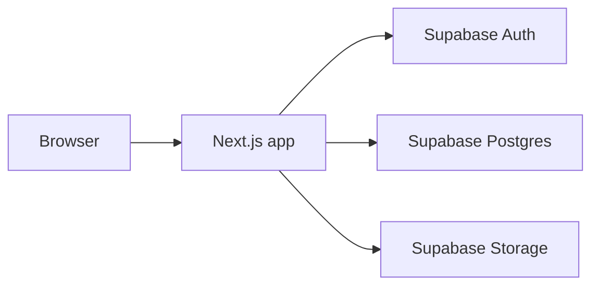

# AvtalePilot MVP Build Plan

## Simple tech stack (chosen for beginners)

| Piece | What it is | Why it helps you |
|-------|------------|------------------|
| **Next.js** | Website framework (React) | One project for pages and server logic; lots of tutorials |
| **TypeScript** | JavaScript with types | Catches mistakes early; Cursor can help more accurately |
| **Tailwind CSS** | Styling with utility classes | Fast UI without deep CSS knowledge |
| **Supabase** | Database + login + file storage | Visual dashboard; auth and Postgres without running your own server |
| **Vercel** (later) | Hosting | One-click deploy from the same Next.js app |

**How the pieces fit:**

You edit the Next.js app in Cursor. Supabase stores users, contracts, and uploaded PDFs. You do not need to manage a separate backend language for the MVP.

---

## Product scope for MVP

**In scope (practical first version):**
- Sign in (email/password) for staff of **one** organization
- Contract library: create, edit, view, search/filter
- Fields: title, supplier, cost, owner, department/location, status, notes
- Key dates: renewal, expiry, notice deadline (separate fields)
- Upload and view the original contract file
- Reminders/tasks: show what needs action soon; notify owners (in-app first; email if easy via Supabase)
- Decision record: Renew / Renegotiate / End, with who decided and when
- Simple company overview: upcoming deadlines list

**Out of scope for MVP (later):**
- AI extraction from PDFs
- Email/calendar sync
- Cost forecasting dashboards
- Full multi-company signup/billing
- Complex permission matrices beyond Admin vs Member

---

## Multi-org readiness (without building SaaS yet)

From day one, every business table includes `organization_id`.

- MVP seeds **one** organization and attaches all users to it
- Queries always filter by the signed-in user’s organization
- Supabase Row Level Security (RLS) enforces that boundary
- Later: add “create organization / invite users” without redesigning contracts, dates, or decisions

---

## Data model (core tables)

- **organizations** — id, name
- **profiles** — user id, organization_id, name, role (`admin` | `member`)
- **suppliers** — organization_id, name, contact info
- **contracts** — organization_id, title, supplier_id, owner_user_id, department/location, cost, status, notes, document path
- **contract_dates** — contract_id, type (`renewal` | `expiry` | `notice`), date
- **reminders** — contract_id, due_date, assignee_user_id, status (`pending` | `done` | `dismissed`)
- **decisions** — contract_id, type (`renew` | `renegotiate` | `end`), decided_by, decided_at, note

This maps directly to the four everyday questions: where is the contract, when to act, who owns it, what was decided.

---

## App screens (MVP)

1. **Login**
2. **Dashboard** — upcoming deadlines and open reminders
3. **Contracts list** — search/filter by supplier, owner, location, deadline
4. **Contract detail** — dates, file, reminders, decision history + “record decision”
5. **New / edit contract** — including file upload
6. **Suppliers list** (simple)
7. **Settings** — org name, invite placeholder (admin only; real multi-org invites later)

UI language: **Norwegian primary** (product name and target users), with clear labels; keep code/identifiers in English.

---

## Build phases

### Phase 0 — Project setup
- Create Next.js + TypeScript + Tailwind app in the empty [Avtalepilot](C:\Users\ffl_2\OneDrive\Desktop\Avtalepilot) folder
- Create Supabase project; connect env vars (URL + keys)
- Add auth helpers and a protected app layout

### Phase 1 — Auth + single organization
- Email/password sign-in
- `organizations` + `profiles` with RLS
- Seed one org; first user as admin
- Redirect unauthenticated users to login

### Phase 2 — Contract library + suppliers
- CRUD for suppliers and contracts
- Store PDFs in Supabase Storage (org-scoped paths)
- List + detail pages with search/filters

### Phase 3 — Dates, reminders, decisions
- Multiple date types per contract
- Generate/show reminders ahead of notice/renewal/expiry (e.g. 90/30/7 days — configurable later)
- Record Renew / Renegotiate / End with history on the contract page
- Dashboard of “needs attention”

### Phase 4 — Polish and deploy
- Empty states, validation, basic error messages
- Seed a few sample contracts for demos
- Deploy to Vercel; document how you run it locally in a short README

---

## How you will work in Cursor

1. Approve this plan
2. We implement **one phase at a time**
3. After each phase you can click through the app and give feedback
4. No AI extraction or multi-tenant signup until the single-org MVP feels solid

---

## Success criteria for MVP

An org user can: add a contract with a file and key dates, see who owns it, get reminded before a deadline, record renew/renegotiate/end, and find that history later — all inside one organization, with the schema ready for more organizations later.
